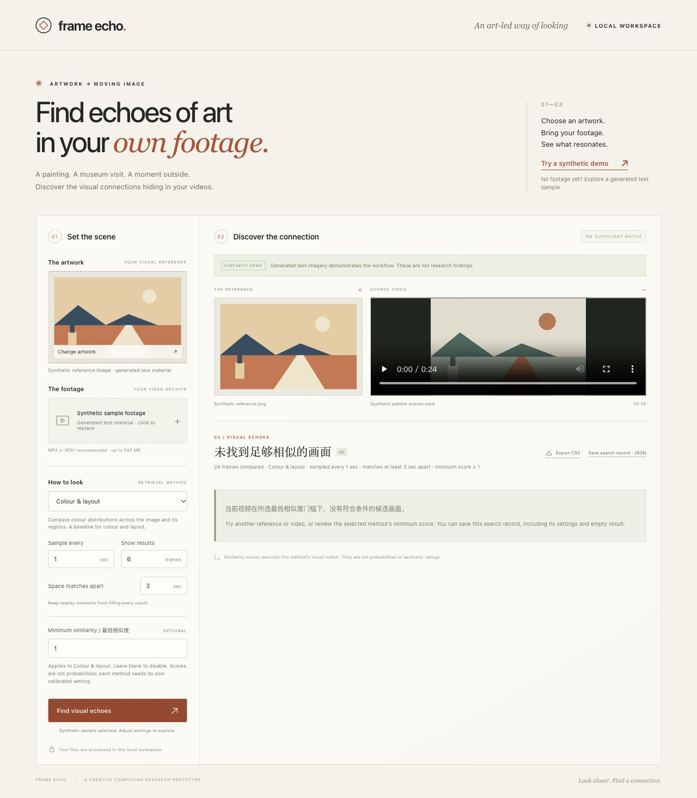

# 最低相似度与无匹配功能验证 — 2026-11-12

本轮将已有 `rank_matches(..., min_score=None)` 过滤接入网站。默认留空，保持原检索行为；填写有限的 -1 至 1 数值后，仅保留 `score >= min_score` 的候选帧。颜色与 CLIP 的分数不能直接互用，页面内分别保留两者的门槛设置。

## 网页使用

1. 打开本地网站，选择艺术作品与视频。
2. 选择检索方法，在 **Minimum similarity / 最低相似度** 中填写待验证门槛；留空即关闭过滤。
3. 点击 **Find visual echoes**。若没有候选帧达到门槛，显示 **“未找到足够相似的画面”**，结果列表为空，所选时间戳清空。
4. 可通过 **Save search record · JSON** 保存素材元数据、设置、状态与空结果。无匹配 CSV 只有表头，不添加虚构匹配行。

## 已观察到的验证结果

完整自动测试：**59 项通过**。覆盖过滤关闭、部分/全部候选被排除、等于门槛时保留、非法值、时间间隔筛选，以及上传/演示请求和导出。原文件备份与完整测试输出在本机忽略目录 `data/private/change-backups/no-match-20261112T232135Z/`。

浏览器使用明确标注的合成演示素材，采样间隔 1 秒、最多 6 帧、最小间隔 3 秒：

| 最低相似度 | 实际返回 | 网页表现 |
| --- | --- | --- |
| 留空 | 6 | 正常显示匹配 |
| 1 | 0 | 显示无匹配提示，所选时间为 `—`，播放器标为 `SOURCE VIDEO` |
| 0.8 | 1 | 恢复显示匹配与时间戳 |
| 0 | 6 | 摘要明确显示 `minimum score ≥ 0`，未误当留空 |

切换到 CLIP 时，其门槛独立为空；设置后切回颜色方法，恢复颜色方法此前的门槛。该检查验证界面状态隔离，未新增 CLIP 模型检索效果评价。

实际下载并核对了无匹配 JSON 和 CSV：JSON 为 `status=complete`、`match_status=no_match`、`min_score=1`、`results=[]`；CSV 仅有一行表头。零结果是正常完成状态。

## 研究范围

以上数值只用于功能测试，不能作为真实素材的推荐门槛，也不能据此声称识别精度提升。A01/V02 是学生提出的一个开发负例：颜色接近不足以证明内容和构图相似；不能仅凭这一个负例确定通用门槛。下一步应记录真实人工评分，并用独立素材检查误收与误拒。提示的含义是当前方法、采样和门槛没有返回合格候选帧，不是证明视频中绝对不存在视觉联系。

Codex 协助了本次实现和验证；未生成或冒充参与者评价。
