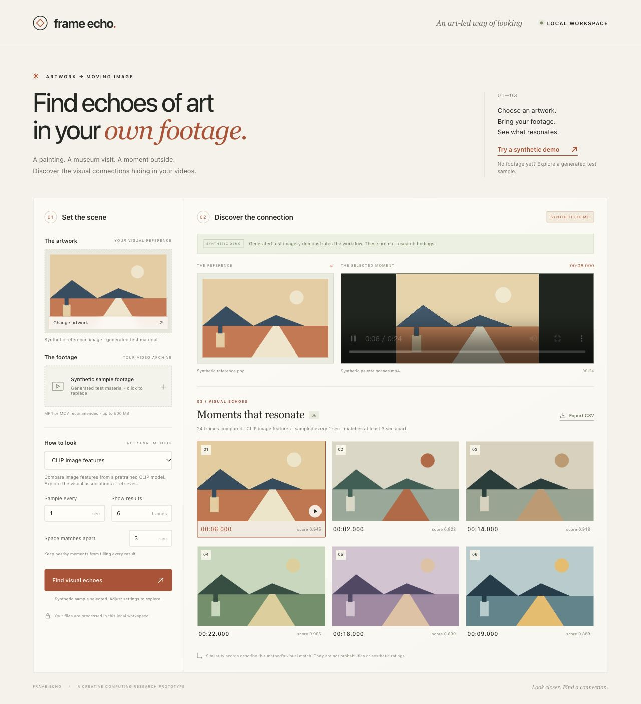
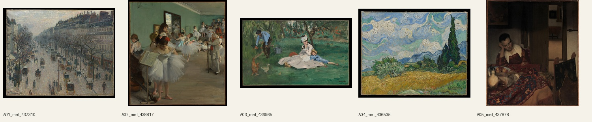
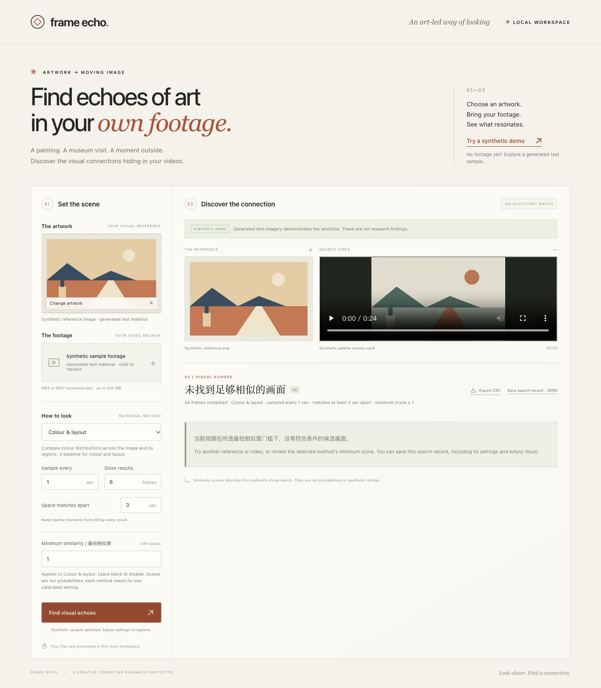
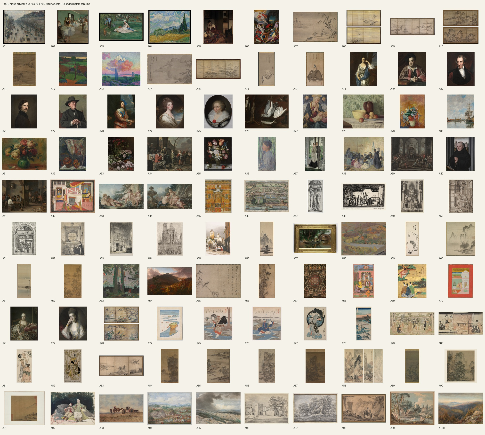
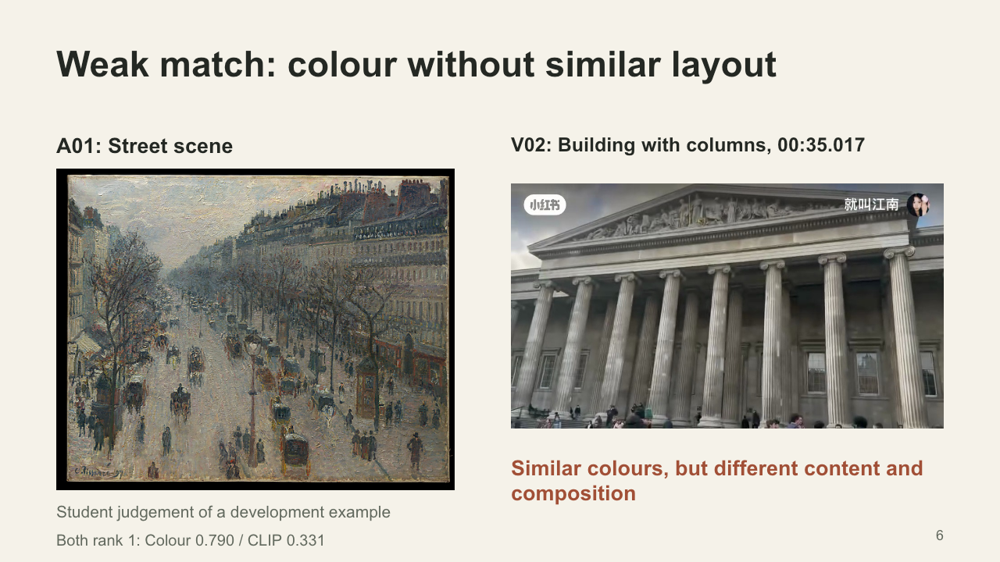
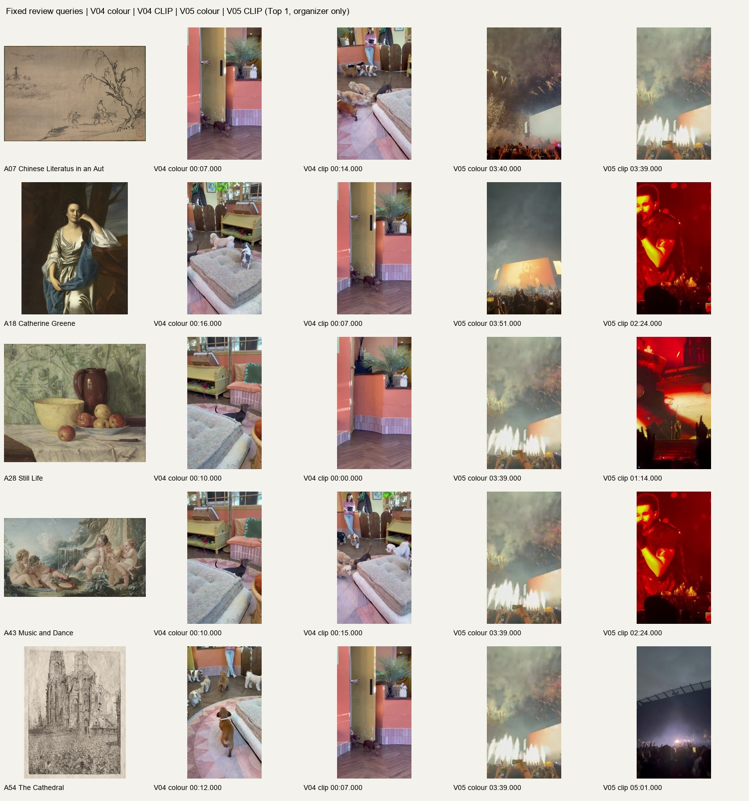
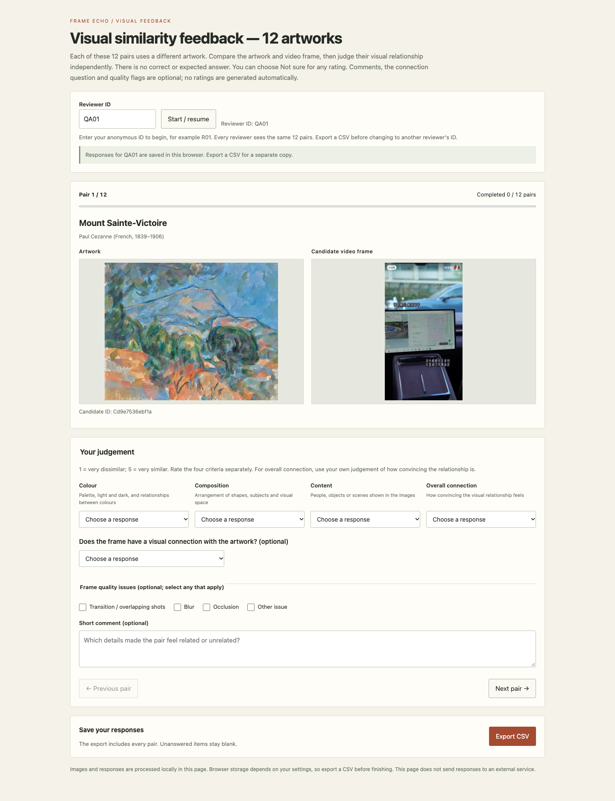
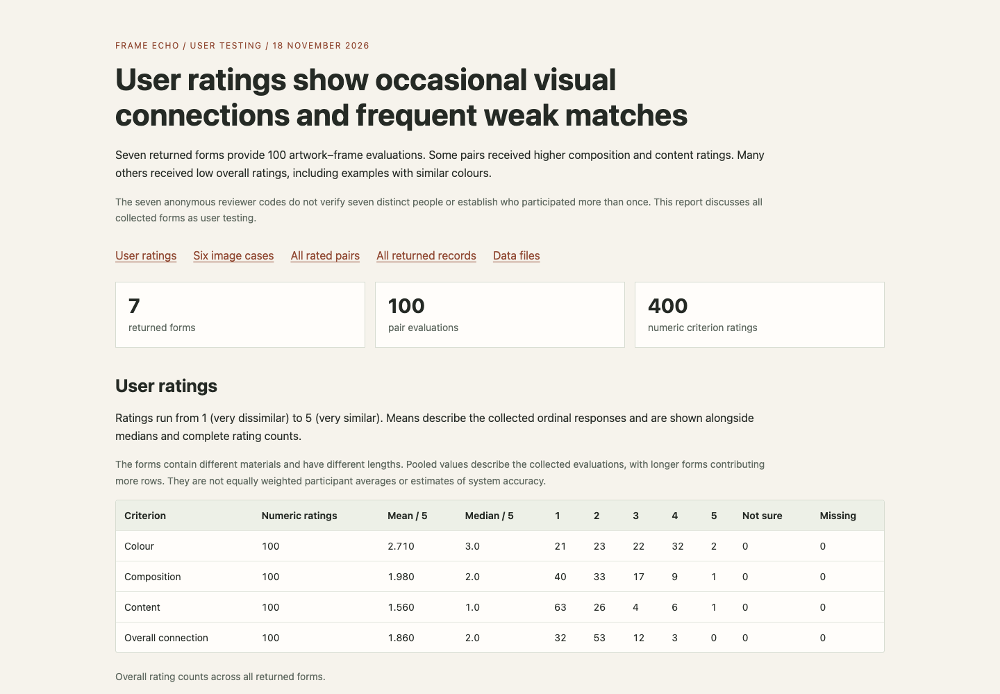
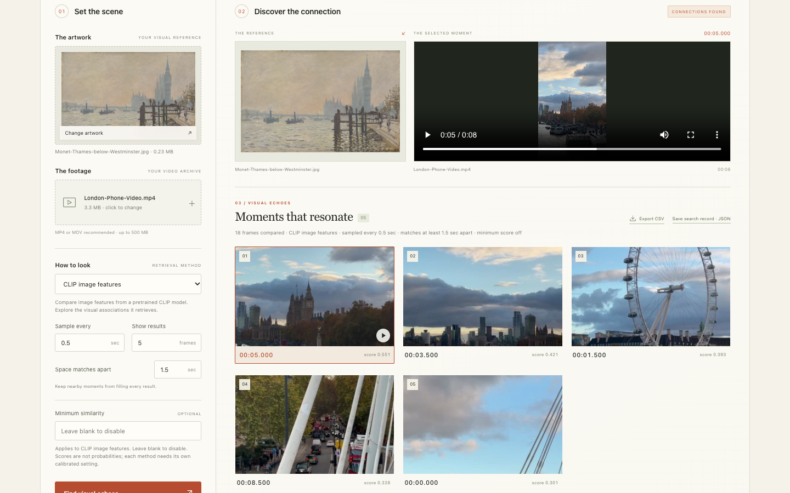

# Frame Echo — Process Development Log

## 30 July 2026 - Firt meeting

The project topic has been defined as exploring the connections between images, with the aim of helping users organise their material and complete the ethical review process.

## 16 October 2026 - Prototype testing

We showed the teacher an early prototype of the project and realised that it did not effectively achieve our objectives. We therefore changed our approach and began exploring connections between famous paintings and videos of everyday life.

## 5 November 2026 — Direction and initial implementation

### Work undertaken

- Reviewed the four required submission elements and the compulsory in-person presentation.
- Implemented a local prototype with a FastAPI backend and a browser interface.
- Defined a colour-feature baseline and an optional pretrained CLIP method as implementation choices.
- Drafted the research brief, dataset and rating templates, evaluation protocol, thesis outline, schedule and submission checklist.

### Rationale

A small retrieval prototype provides a concrete object for testing before the final write-up. Comparing two feature approaches offers a way to investigate what “similar” means for this material. Source timestamps connect each result back to the recorded experience. Separating identity matches in museum footage avoids conflating recognition of the same work with wider visual analogy.

### Evidence and verification status

Completed the initial implementation and documentation following supervisor guidance. Verified OpenCLIP encoding, passed 22 tests, checked both methods on synthetic video, and fixed timestamp handling. Saved the [screenshot](figures/prototype.jpg) and [verification details](verification.md).

Further review and real-data evaluation remain pending. Synthetic results verify functionality only and must remain labelled as synthetic.

**Figure 1.** Early Frame Echo interface tested with synthetic geometric footage and a reference image.

### Next Steps

- Review the working prototype and conduct a test using real-world materials.
- Provide a small batch of real-world video and artwork queries, complete with source information.
- Conduct a pilot test to determine viable configurations and assess the workload.

## 10 November 2026 — First real-footage pilot

Completed 30 pilot conditions using five public-domain Met paintings and 353 shared frames, producing 180 ranked results (K=6; 3-second spacing). Review found plausible matches, limited query discrimination and a bright transition frame ranked first by CLIP. No participant ratings were collected or method superiority claimed.

Kept baselines unchanged; quality filtering and crop policy are next experiments. Saved the [report](pilot-2026-11-10.md) and diagnostics, and added `scripts/run_pilot.py` for hash-checked offline reproduction.

**Figure 2.** The five public-domain paintings from The Metropolitan Museum of Art used as references in the first real-footage pilot. [Artwork sources](data-manifest.csv).

### 10 November 2026 — Balanced visual similarity development comparison

Defined similarity across colour, composition and content. Added experimental temporal filtering, mean-colour padding and rank fusion (0.5/0.25/0.25; k=60), preserving defaults and the first pilot. Completed 75 conditions and 450 records; all 15 baseline CLIP rankings reproduced. Heuristic flags (11/353) are not human quality labels.

Fixed seek alignment; 49 tests passed. Prepared and statically checked a blinded feedback page with 24 unrated diagnostic pairs, not a held-out evaluation. No improvement or participant findings are claimed.

Next: collect feedback, inspect possible false exclusions and select a configuration using fresh evaluation material. [Report](visual-round2-2026-11-10.md).

## 12 November 2026 — Optional similarity gate and no-match outcome

- Changes: Added optional similarity thresholds and auditable no-match handling, preserving defaults and separate colour/CLIP settings.

- Validation: 59 tests passed; browser checks confirmed filtering and empty-result exports.

- Next: Use human ratings and fresh material to assess false inclusions/exclusions and select thresholds.

**Figure 3.** The synthetic demo with a minimum score of 1. The interface shows the empty-result state and keeps the export controls available.

## 13 November 2026 — Expansion to 100 artwork queries

- Changes: Expanded to 100 artworks (5 Met + 95 Cleveland CC0), audited sources, and updated reports and presentation.

- Validation: Completed 600 conditions and 3,600 rankings across 3 videos; all 30 original conditions reproduced. Source and static checks passed. No new browser test, human ratings or accuracy estimates.

- Next: Add recorded videos, complete existing video provenance and collect human judgements.

**Figure 4.** The expanded set of 100 queries combined five works from the Met and 95 from the Cleveland Museum of Art. [Artwork sources](data-manifest.csv).

## 13 November 2026 — Diagnostic cases for the progress presentation

- Changes: Reviewed 600 Top 1 comparisons, selected illustrative matches and failures, and expanded the presentation to nine slides with bilingual notes.

- Validation: Checked source images, frames and descriptive counts. Some useful examples scored below weak matches, highlighting threshold limitations. This was preliminary Codex review, not participant evaluation.

- Next: Collecting user research

**Figure 5.** The A01 comparison from the progress presentation. The street and colonnade share muted colours and differ in scene content and composition. V02 frame at 00:35.017. [Footage source](data-manifest.csv).

## 2026-11-15 — New self-recorded footage and a fixed human-rating set

- Changes: Added two self-recorded videos, completed 400 conditions and 2,318 ranked results, and prepared 20 unrated pairs with an offline rating page.

- Validation: Reproduced all rankings from saved features, checked image provenance and verified browser exports using temporary QA data.

- Next: Collect anonymous ratings, analyse comments and revise Evaluation/Discussion using the findings.

**Figure 6.** Selection sheet for the 20 unrated pairs from the self-recorded dog café and concert footage.

## 2026-11-16 — Shorter rating version after two reported respondents

- Shortened the rating task from 20 to 12 pairs after two classmates reported repetition, using the first three queries in the original order.
- Browser tests with simulated responses verified session isolation, CSV export and mobile layout.
- Analyse shared pairs across versions, report the extra eight separately, and document changes in workload and item positions.

## 2026-11-16 — Diverse artwork questionnaires with 12 pairs (v3)

- Created 12 balanced forms with 12 distinct artworks each: four shared anchors and eight rotating artworks.
- Audited all 144 assignments. Browser tests with simulated responses verified session isolation and CSV exports.
- Collect ratings with the new forms and verify the two earlier CSVs separately.

## 2026-11-17 — First four returned human-feedback exports

- Analysed four feedback exports covering 64 completed pair evaluations and documented five illustrative cases.
- An independent audit verified all records and summaries. Of 20 paired comparisons, 12 tied, five favoured CLIP and three favoured colour.

## 2026-11-17 — Human feedback added to the short thesis

- Updated the thesis Evaluation and Discussion using four verified feedback exports.
- Checked all 12 rendered pages and corrected the contents links and page numbers.

## 2026-11-17 — Twelve new artwork queries across five saved videos

- Tested 12 new CC0 artworks across five videos, producing 716 ranked results from 120 conditions.
- Independent replay reproduced all rankings exactly. In V01, the same bright transition ranked first for 9 of 12 CLIP queries and 4 of 12 colour queries.

## 2026-11-17 — Separate twelve-artwork supplemental questionnaire (SUP12)

- Built a fixed questionnaire with 12 distinct artworks, six colour results and six CLIP results across five videos.
- Collect anonymous ratings and let returning reviewers reuse their existing IDs.

**Figure 7.** Test view of the supplemental 12-artwork questionnaire, with the four rating fields left blank. QA01 is a test ID. [Cleveland Museum of Art](https://clevelandart.org/art/1958.21), [V01 footage source](data-manifest.csv).

## 2026-11-18 — User testing across seven returned forms

- Combined seven returned forms into one user-testing report covering 100 pair evaluations and six illustrative cases.
- Overall similarity averaged 1.86/5, with 85 of 100 ratings at 1 or 2.

**Figure 8.** User-testing report with the aggregated ratings by colour, composition, content and overall connection.

## 2026-11-20

**Figure 9.** Final demonstration using Claude Monet’s *The Thames below Westminster* and self-recorded Thames footage. OpenCLIP ranked the frame at 00:05.000 first among 18 sampled frames. [Artwork source](https://www.nationalgallery.org.uk/paintings/claude-monet-the-thames-below-westminster).